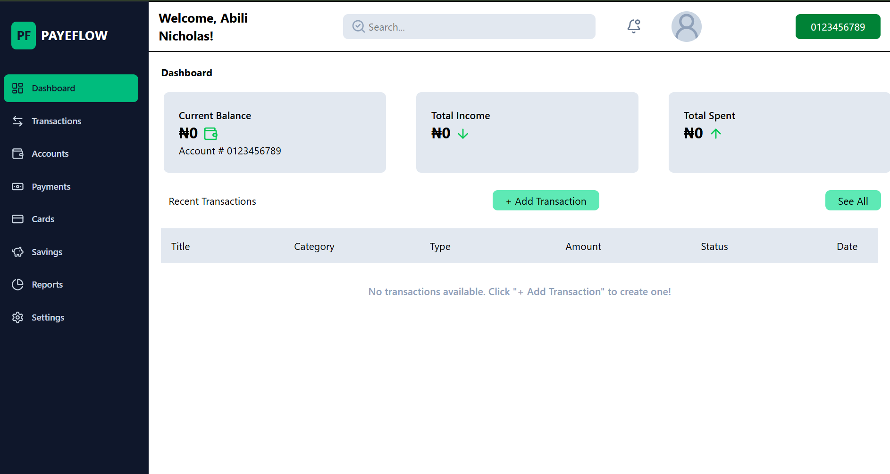

# PayeFlow — Personal Finance & Transaction Dashboard

A responsive, full-stack fintech web application designed to track personal cash flow, manage account balances, and monitor real-time credits and debits through a clean, mobile-first interface.

🔗 Live Demo: https://dashboard-dzyu1oubt-abidum2001-6526s-projects.vercel.app/

🔗 Backend API: https://personal-finance-dashboard-s6ua.onrender.com/api/transactions

---

## 📸 Preview

> * *

---

## ✨ Key Features

- Real-Time Balance & Cash Flow Tracking: Automatically calculates and updates Current Balance, Total Income, and Total Spent as new transactions are logged.
- Transaction Management: Create, categorize, and inspect detailed transaction records (Credits/Debits across categories like Transfers, Salary, Groceries, and Utilities) with timestamps and status indicators.
- Instant Search & Filtering: Quickly locate specific transactions by title, category, or type using live search queries.
- Responsive Dashboard Layout: Built with a clean sidebar navigation system and adaptive card layouts that scale seamlessly from mobile screens to desktop monitors.
- RESTful Full-Stack Architecture: Decoupled React frontend communicating securely with a custom Node.js/Express API and cloud-hosted MongoDB database.

---

## 🛠️ Tech Stack

Frontend
- Framework: React (Vite)
- Styling: Tailwind CSS
- HTTP Client: Fetch / Axios
- Deployment: Vercel

Backend
- Runtime & Framework: Node.js, Express.js
- Database: MongoDB & Mongoose
- Deployment: Render

---

## 🚀 Getting Started Locally

To run this project locally on your machine, follow these steps:

### 1. Clone the repository
    https://github.com/Neekbillzz/Personal--Finance-Dashboard
    cd your-repo-name

### 2. Install dependencies

    npm install

### 3. Configure environment variables
Create a .env file in the root of your frontend directory and point it to your backend API URL (without a trailing slash):
      
    npm run dev    

## 🔌 Core API Endpoints

    ### Transactions & Dashboard
| Method | Endpoint | Description | .
| :--- | :--- | :--- | :---: |
| POST | /api/transactions | Create a new credit (income) or debit (expense) transaction
| DELETE | /api/transactions/:id | Delete a transaction and recalculate balance

###  Author

Abili Nicholas Dumebi  
GitHub: https://github.com/Neekbillzz  
LinkedIn: https://www.linkedin.com/in/abilinicholas/